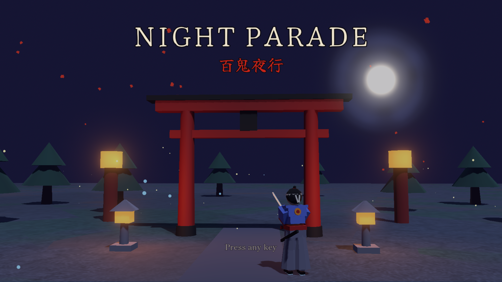

# Night Parade: a Samurai Survivor Game

Night Parade is a low-poly isometric action survivor. A lone samurai fights waves of yokai (Japanese folklore monsters) from dusk until dawn. A night lasts 3, 5, 10 or 15 minutes. There is also a Duel mode: no horde, just one boss.

## Demo WASM

The game then runs inside a web page using WebGL 2, with the simpler Compatibility renderer (the web does not support the desktop one).

- **Single-threaded:** no special server settings are needed, so any static host works.
- **Hosting:** Cloudflare Workers, as plain static files, planned for a custom subdomain.
- **Size:** the engine file is about 38 MiB, over Cloudflare's 25 MiB per-file limit. The build splits it into pieces, and a tiny Worker joins them back into one file when a browser asks.
- **Safety:** there are no accounts, no network calls and no secrets. Saves live in the player's own browser.

## References

- Miyamoto Musashi, *The Book of Five Rings*. The five schools. Public domain.
- Japanese folklore (yokai). The monsters. Public domain as a subject; all designs here are original.
- [Godot Engine](https://godotengine.org/) for the game engine.
- [Blender](https://www.blender.org/) for building characters.
- [Kenney](https://kenney.nl/) for the free CC0 sound packs.
- [WebAssembly](https://webassembly.org/) for running the game in a browser.
